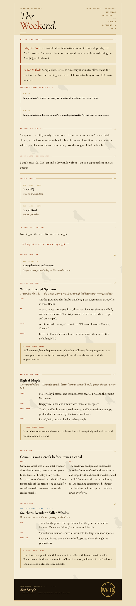

# Weekend Dispatch (showcase)

A Saturday-morning newsletter for one reader. The email is a small envelope that opens into a full newsletter hosted on GitHub Pages. That newsletter covers subway changes on the reader's lines, weather and dog-walk windows, a farmers-market go/no-go, shows worth going to, Brooklyn culture news, and a rotating set of nature sections. I built it with Claude Code and it runs from a GitHub Actions workflow.

**This is a showcase copy.** Personal details were swapped for a fictional reader ("Alex Sample," who lives near Fort Greene Park with a dog named Biscuit), the venues and artists are placeholders, the schedule is turned off, and no keys are included. The code is complete, but this repo isn't wired to send anything.

| The email | The newsletter it opens |
|---|---|
|  |  |

## What's in it

1. **MTA this weekend.** Every current alert on the reader's lines, pulled from the MTA's GTFS-realtime feed and filtered to the Saturday–Sunday window. A banner covers the two home stations and suggests the nearest station that's still running. Buses, the AirTrain and the LIRR show up only when they're actually disrupted.
2. **Weather and dog walks.** Hourly forecast from Open-Meteo, with walk windows that account for pavement heat.
3. **Greenmarket go/no-go.** A rule-based verdict from rain chance and sustained heat across the outing window.
4. **A featured venue and the DICE watchlist.** Shows at tracked venues and by tracked artists, read from DICE profile pages. A companion "long list" page covers every going-out night for the next two weeks.
5. **Around Brooklyn.** Culture news from local feeds, filtered against the reader's interests, plus Edible Brooklyn picks ranked by neighborhood.
6. **Nature and history.** A bird, a tree and a "then and now" story from a hand-checked bank rotated by week (no generated text). Also a Map of the Week of one neighborhood's street trees on a USGS aerial photo, and shore conditions from NOAA tides and buoys.

## How it works

```
GitHub Actions (Saturday morning)
        |
weekend_dispatch.py
  |-- MTA GTFS-realtime alerts, Open-Meteo, GrowNYC, DICE, RSS feeds,
  |   NYC Open Data and Planning Labs, USGS imagery, NOAA tides and buoys, Wikimedia
  |-- Claude API: writes the weather, market and news sections
  |-- builds the newsletter and the long list -> commits them to GitHub Pages
  |-- builds the envelope: Pillow stamps the date into the postmark of an envelope photo
        |
Gmail SMTP -> inbox (envelope links to the hosted newsletter)
```

A few details worth a look:

- **Reading DICE.** DICE's browse pages only reach a few days ahead, but venue and artist profile pages embed the same JSON for a whole run of shows, months out. The watchlist reads those profile pages, so the email can name a show on the following Friday. See `fetch_dice_watchlist()`.
- **Alerts that matter.** `fetch_surface_transit_alerts()` keeps a watched service only when its alert text says it's cut, rerouted or suspended. Otherwise the service isn't mentioned at all.
- **Hand-checked content.** The nature and history sections draw from a fixed bank with sources, so no model writes facts the reader might act on.
- **Preview without sending.** `python3 weekend_dispatch.py --preview` builds the newsletter locally from live data with no email and no git.

## Files

| File | What it is |
|---|---|
| `weekend_dispatch.py` | The whole dispatch: fetchers, rules, Claude calls, newsletter, envelope, sender |
| `sample_profile.py` | The fictional reader's settings (location, stations, interests, watchlist) |
| `render_sample.py` | Renders the envelope, newsletter and long list from fictional data with the network blocked |
| `.github/workflows/weekend_dispatch.yml` | The Saturday workflow (schedule disabled here) |
| `assets/` | Pigeon artwork, a placeholder crest and envelope, and the Jost font (SIL OFL) |
| `sample/` | The rendered samples and their screenshots |

To render the samples yourself: `python3 render_sample.py`. It needs `requests`, `beautifulsoup4`, `anthropic`, `pillow`, `numpy`, `feedparser` and `lxml` installed.

## What changed for this public copy

- Home location, stations, cross streets, interests, the dog's name, and the tracked venues and artists were replaced with fictional values in `sample_profile.py` or rewritten in place.
- Email credentials and API keys are read from environment variables and were never committed.
- The personal envelope photo, wax seal and crest were replaced with neutral placeholders.
- The neighborhood rotation for the Map of the Week was reordered so it no longer centers on a real home.
- The repo starts with a fresh history.

## About

Built by Zachary Tharpe ([LinkedIn](https://www.linkedin.com/in/zachary-tharpe)), with Claude Code.

All rights reserved. The code is shared so people can read it; no license is granted to reuse it.
